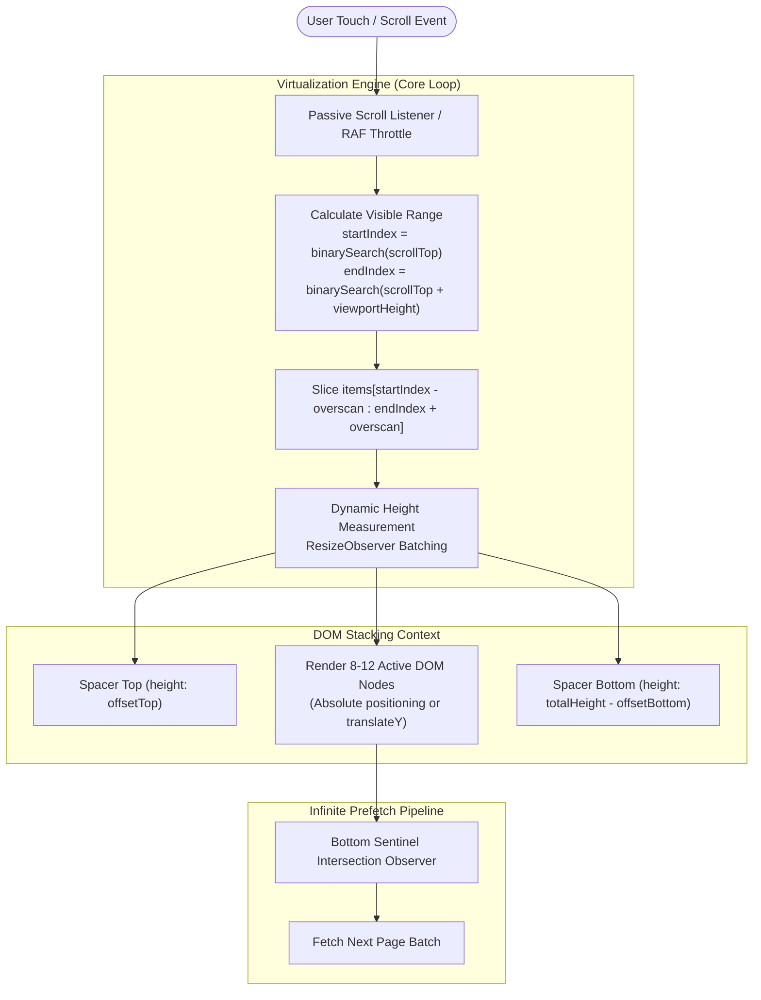

# Design an Infinite Scroll & Virtualized Feed (Instagram / Twitter)

## Step 1: Clarify Requirements

### Functional Requirements
- **Smooth Infinite Scrolling**: Continuously load and render hundreds of thousands of feed items as the user scrolls down (or up).
- **DOM Virtualization (Windowing)**: Maintain a constant, minimal number of DOM nodes in the browser (e.g., ~15 to 25 items) regardless of how many thousands of items have been loaded into memory.
- **Dynamic Variable Heights**: Support feed items with variable, unpredictable heights (text posts, images with varying aspect ratios, videos, comments) without layout jitter or scroll jumping.
- **Scroll Restoration**: Preserve exact scroll position when navigating away to a detail view and pressing the browser "Back" button.
- **Bidirectional Loading & Prefetching**: Prefetch upcoming pages ahead of the user's viewport using `IntersectionObserver` before they hit the bottom edge.

### Non-Functional Requirements
- **Butter-Smooth 60fps / 120fps Scrolling**: Frame render time must stay strictly under **16.6 ms** (or **8.3 ms** on ProMotion 120 Hz displays) to prevent scroll jank.
- **Bounded Memory Consumption**: Memory footprint must remain flat (<100 MB RAM) even after scrolling past 50,000 feed posts on low-end mobile devices.
- **Zero Layout Shifts (CLS = 0)**: Prevent visual jumps as images and asynchronous items resolve their heights.

---

## Step 2: Performance Budgets & Scale

### Browser Resource Constraints
- **Total Feed Items Available**: 50,000+ items in an active user session.
- **The Native DOM Problem**:
  - Rendering 10,000 native DOM nodes creates millions of CSSOM style calculations and layout recalculations.
  - Browser memory spikes to **>1.2 GB RAM**, causing Garbage Collection (GC) pauses and browser tab crashes on mobile devices.
- **Virtualization Budget**:
  - Visible Viewport Height: 800 px.
  - Average Item Height: 400 px (~2 items visible at any given moment).
  - Buffer Overscan: 3 items above + 3 items below the viewport.
  - **Active DOM Nodes in Memory**: Strictly **8 to 12 active DOM nodes** at all times!

---

## Step 3: Component Architecture & Public API

### Component Interface
```tsx
interface VirtualFeedProps<T> {
  items: T[];
  estimateItemHeight: (index: number) => number;
  renderItem: (item: T, index: number) => React.ReactNode;
  overscan?: number; // Number of items to render outside visible viewport (default: 3)
  onEndReached?: () => void; // Trigger for next page fetch
  onEndReachedThreshold?: number; // Distance in pixels from bottom to trigger fetch
}
```

### The Windowing Coordinate Math
```text
Virtual Container (Total Height = sum of all estimated heights):
┌────────────────────────────────────────────────────────┐
│ Spacer Top: height = 3,200px (transform: translateY)   │  <-- Pushes visible items down
├────────────────────────────────────────────────────────┤
│ [Overscan Item 7]                                      │
│ [Visible Item 8]   <── VIEWPORT TOP (ScrollTop: 3,400) │
│ [Visible Item 9]                                       │
│ [Overscan Item 10] <── VIEWPORT BOTTOM                 │
├────────────────────────────────────────────────────────┤
│ Spacer Bottom: height = 18,400px                       │  <-- Preserves full scrollbar
└────────────────────────────────────────────────────────┘
```

---

## Step 4: High-Level Architecture & Pipeline



---

## Step 5: State Machine & Data Structures

To determine which items to render in $O(\log N)$ time:
1. **Size and Offset Cache (`Array<ItemMeasurement>`)**:
   ```typescript
   interface ItemMeasurement {
     index: number;
     offset: number; // Cumulative distance from top in pixels
     size: number;   // Measured or estimated height
   }
   ```
2. **Binary Search Lookup**:
   - Given the current `scrollTop`, perform a binary search on the `offset` array to locate the `startIndex` in **$O(\log N)$** time instead of an $O(N)$ linear scan.
   - Example: For 100,000 items, binary search finds the first visible item in just **17 iterations** (<0.01 ms).

---

## Step 6: Deep Dive: Variable Heights, Anchoring & Jitter

### 1. The Dynamic Height Measurement Problem
In feeds with user-generated content, image sizes and text lengths cannot be predicted accurately before rendering:
- **Phase 1 (Initial Render)**: Use an initial height estimate (e.g., 300 px) to render initial placeholders.
- **Phase 2 (ResizeObserver Measurement)**:
  - Attach a single shared `ResizeObserver` to the container.
  - As nodes mount, measure their exact `entry.borderBoxSize` and update the size cache.
  - Recompute cumulative offsets for subsequent items.
- **Phase 3 (Batching Updates)**:
  - Never update state inside the `ResizeObserver` callback synchronously! Doing so triggers layout thrashing.
  - Batch size updates inside a `requestAnimationFrame` callback to update DOM dimensions once per frame.

### 2. Scroll Anchoring (Preventing Upward Scroll Jumps)
When scrolling **upward** or when dynamic content above the current viewport changes height:
- If an item above the viewport expands by 50 px, the user's view will suddenly jump downward by 50 px!
- **Solution: Delta Correction (Scroll Anchoring)**:
  ```javascript
  const heightDelta = newHeight - oldHeight;
  if (itemIndex < visibleStartIndex) {
    // Correct the browser's scroll position by the exact delta
    container.scrollTop += heightDelta;
  }
  ```
  - Modern browsers provide CSS `overflow-anchor: auto`, but manual delta correction is required for recycled virtual containers to guarantee zero jitter.

### 3. Recycled DOM Nodes vs. Key Replacement
- In standard React, changing the `key` prop unmounts and remounts components, forcing expensive layout and image re-fetching.
- **Pool Recycling**: Keep persistent container elements and swap the internal data context, preserving DOM node instances and avoiding garbage collection overhead.
