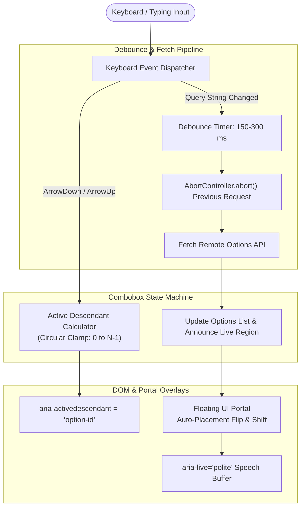

# Design an Accessible Combobox / Autocomplete Component (Radix / Headless UI)

## Step 1: Clarify Requirements

### Functional Requirements
- **Interactive Search & Filter**: Users type text into an input to filter a list of options in an anchored dropdown listbox.
- **Full Keyboard Navigation**: Comprehensive navigation using arrow keys (`ArrowDown`, `ArrowUp`), `Home`, `End`, `Enter` to select, and `Escape` to dismiss.
- **Strict W3C WAI-ARIA 1.2 Accessibility**: Screen reader users must receive clear announcements of menu state, highlighted items, and count of matching results without losing keyboard focus.
- **Async Remote Fetching**: Support debounced network queries with instant cancellation of stale in-flight requests (`AbortController`).
- **Flexible Compound Component API**: Allow consumers to customize rendering (custom option cards, avatars, badges, multi-select tags) without breaking internal accessibility semantics.

### Non-Functional Requirements
- **Zero Input Latency**: Keystroke typing must feel instantaneous (<16 ms) without main-thread blocking or frame drops.
- **Floating Collision Detection**: Popover must intelligently flip (render above if insufficient room below) and handle window resizing using modern portal overlays.
- **Rock-Solid Robustness**: Gracefully handle network timeouts, zero search results, and fast typing bursts.

---

## Step 2: WAI-ARIA 1.2 Specification & Accessibility Contract

A standard `<input>` + `<ul>` combination is invisible to assistive technologies unless wired with strict ARIA roles and relationships:

```html
<!-- Input Combobox Container -->
<input 
  role="combobox"
  aria-expanded="true"
  aria-haspopup="listbox"
  aria-controls="combobox-options-list"
  aria-autocomplete="list"
  aria-activedescendant="option-item-2"
/>

<!-- Dropdown Options Listbox -->
<ul id="combobox-options-list" role="listbox" aria-label="Search suggestions">
  <li id="option-item-0" role="option" aria-selected="false">System Design</li>
  <li id="option-item-1" role="option" aria-selected="false">Distributed Systems</li>
  <li id="option-item-2" role="option" aria-selected="true" class="highlighted">Microservices</li>
</ul>

<!-- Hidden Live Region for Dynamic Screen Reader Counts -->
<div role="status" aria-live="polite" class="sr-only">
  3 suggestions found. Use up and down arrows to review.
</div>
```

---

## Step 3: Compound Component API Design

```tsx
<Combobox value={selected} onChange={setSelected} filterItems={searchQuery}>
  <Combobox.Input placeholder="Search architectures..." />
  <Combobox.Popover>
    <Combobox.Empty>No topics found.</Combobox.Empty>
    <Combobox.List>
      {(item) => (
        <Combobox.Option key={item.id} value={item}>
          <TopicIcon type={item.type} />
          <span>{item.title}</span>
        </Combobox.Option>
      )}
    </Combobox.List>
  </Combobox.Popover>
</Combobox>
```

---

## Step 4: Finite State Machine (FSM)

```text
Combobox State Transitions:
        ┌─────────────┐
        │   CLOSED    │ <──────────────────────────────┐
        └──────┬──────┘                                │
               │ Focus / Typing / ArrowDown            │ Escape / Blur / Select
               ▼                                       │
        ┌─────────────┐   ArrowDown / ArrowUp   ┌──────┴──────┐
        │    OPEN     │ ──────────────────────> │ NAVIGATING  │
        └──────┬──────┘                         └─────────────┘
               │ Async Query Triggered
               ▼
        ┌─────────────┐
        │   LOADING   │
        └─────────────┘
```

---

## Step 5: High-Level Pipeline & Architecture



---

## Step 6: Deep Dive: Active Descendant, Race Conditions & Portals

### 1. `aria-activedescendant` vs. Moving DOM Focus
Why must you NEVER call `optionElement.focus()` when the user presses `ArrowDown` in an autocomplete input?
- If focus physically moves from `<input>` to `<li>`:
  1. The user can no longer type or edit their search query!
  2. The virtual keyboard on mobile devices collapses and closes.
  3. Form `onChange` events stop firing.
- **The Solution: `aria-activedescendant`**:
  - The DOM focus stays permanently fixed inside the `<input>` element.
  - As the user presses `ArrowDown`, update `aria-activedescendant="option-item-{index}"`.
  - The browser's accessibility layer automatically links the focused input to the selected list item, speaking its label to the screen reader while keeping the user's cursor free to type!

### 2. Network Race Conditions & Stale Query Resolution
What happens if the user types `"R"`, then `"Re"`, then `"Redis"` in rapid succession?
```text
Network Timeline (Without Cancellation):
Query 1 ("R")     ──> [Slow 500ms Network] ──────────────────────────> Arrives LAST! (Overwrites results)
Query 2 ("Re")    ──> [Fast 150ms Network] ────────> Arrives SECOND
Query 3 ("Redis") ──> [Fast 100ms Network] ──> Arrives FIRST!
```
- If Query 1 finishes last, the dropdown displays results for `"R"` even though the user input shows `"Redis"`!
- **Solution: `AbortController`**:
  ```typescript
  let currentController: AbortController | null = null;

  async function fetchOptions(query: string) {
    if (currentController) {
      currentController.abort(); // Instantly cancel previous network fetch
    }
    currentController = new AbortController();
    
    try {
      const res = await fetch(`/api/search?q=${query}`, { signal: currentController.signal });
      const data = await res.json();
      setOptions(data);
    } catch (err: any) {
      if (err.name === 'AbortError') return; // Ignore intentional cancellations
      handleError(err);
    }
  }
  ```

### 3. Floating UI: Viewport Collisions & Portal Rendering
Dropdown listboxes rendered inside nested components often get clipped by parent `overflow: hidden` or `z-index` stacking context traps:
- **Solution: React Portal + Floating UI Math**:
  - Render the popover listbox into `document.body` via `createPortal()`.
  - Compute coordinates using `getBoundingClientRect()` of the anchor input.
  - Implement dynamic flip: if `spaceBelow < popoverHeight` and `spaceAbove > spaceBelow`, render the popover **above** the input.
