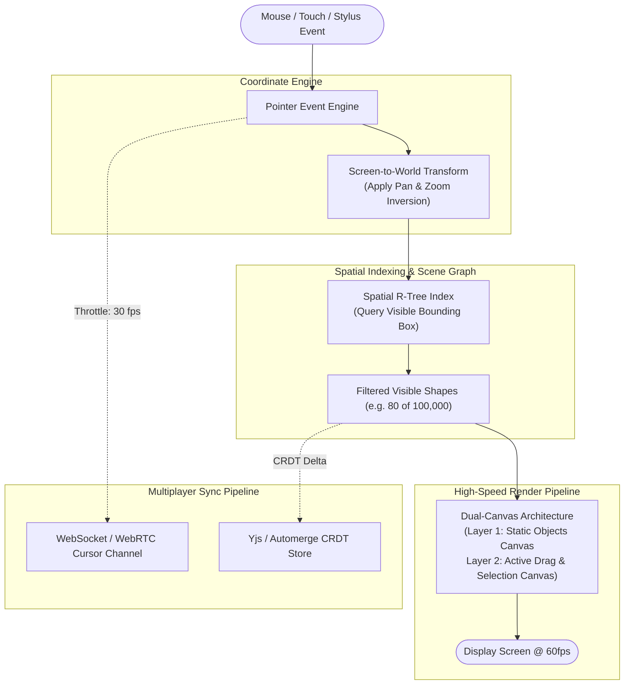

# Design a Collaborative Canvas & Whiteboard (Figma / Miro)

## Step 1: Clarify Requirements

### Functional Requirements
- **Infinite 2D Canvas**: Smooth infinite panning and zooming (from 2% to 2,064% zoom levels) without boundary limits.
- **Rich Vector Entities**: Create, select, resize, rotate, and group vector primitives (rectangles, ellipses, bezier curves, text, connectors).
- **Sub-16 ms Render Loop**: Interactive drawing, dragging, and transformation updates rendered at **60fps / 120fps**.
- **Real-Time Multiplayer Collaboration**: Display live multi-user cursors with usernames and synchronize simultaneous shape edits with zero conflict loss.
- **Undo / Redo History**: Full local and global history traversal using the Command pattern.

### Non-Functional Requirements
- **Extreme High Performance**: Capable of handling **100,000+ vector shapes** in a single document without browser lag or memory starvation.
- **Sub-50 ms Multiplayer Sync**: Peer cursor coordinates and shape changes must propagate over WebSockets/WebRTC with sub-50 ms perceived latency.
- **Offline Resilience**: Allow users to continue sketching offline and automatically merge changes when network connectivity returns.

---

## Step 2: Technology Choice: SVG vs. Canvas 2D vs. WebGL

| Metric | DOM / SVG | HTML5 2D Canvas | WebGL / WebGPU |
|---|---|---|---|
| **Element Representation** | Real DOM Nodes (`<svg>`, `<rect>`) | Immediate Mode Bitmaps | GPU Shaders & Buffers |
| **100,000 Shapes Performance** | **Unusable** (>5,000 DOM nodes crashes mobile browser) | Fast (with Viewport Culling) | **Blazing Fast** (Full GPU parallelism) |
| **Event Handling** | Built-in native DOM listeners | Manual raycasting & hit testing | Manual GPU picking / hit testing |
| **Text Rendering & Styling** | Crisp native browser typography | Moderate (Canvas `fillText`) | Complex (Signed Distance Fields / Atlas) |
| **Industry Verdict** | Small diagrams (<500 shapes) | Miro / Excalidraw (<50,000 shapes) | **Figma (Custom WebAssembly + WebGL engine)** |

---

## Step 3: World vs. Screen Coordinate Transformation Math

An infinite canvas exists in **World Space** ($x_w, y_w$), while browser mouse clicks happen in **Screen Space** ($x_s, y_s$):

```text
World Space (Infinite Canvas)               Screen Space (Viewport: 1920x1080)
┌───────────────────────────────┐           ┌──────────────────┐
│ (0, 0)                        │           │ (0, 0)           │
│         [Shape @ 5000, 4200]  │ ──Pan/Zoom──> [Rendered Pixel]
│                               │           │                  │
└───────────────────────────────┘           └──────────────────┘
```

### Transformation Formulas:
Given viewport camera offsets $(pan_x, pan_y)$ and zoom scale factor $S$:
1. **Screen-to-World (Click Hit-Testing)**:
   $$x_w = \frac{x_s - pan_x}{S}, \quad y_w = \frac{y_s - pan_y}{S}$$
2. **World-to-Screen (Rendering Calculation)**:
   $$x_s = (x_w \times S) + pan_x, \quad y_s = (y_w \times S) + pan_y$$

---

## Step 4: High-Level Architecture & Render Pipeline



---

## Step 5: Scene Graph Data Model

The document is modeled as an ordered **Scene Graph**:
```typescript
interface CanvasShape {
  id: string;
  type: 'rectangle' | 'ellipse' | 'path' | 'text';
  x: number;
  y: number;
  width: number;
  height: number;
  rotation: number;
  fill: string;
  stroke: string;
  zIndex: number;
}

interface SceneGraph {
  rootIds: string[];
  shapes: Map<string, CanvasShape>;
  selection: Set<string>;
  camera: { panX: number; panY: number; zoom: number };
}
```

---

## Step 6: Deep Dive: Viewport Culling, Dual-Canvas & CRDTs

### 1. Spatial Viewport Culling via R-Trees
If a whiteboard contains 100,000 shapes, iterating over all of them inside a `requestAnimationFrame` loop takes **>45 ms**, dropping the framerate to unplayable levels (<20fps):
- **The Solution: R-Tree Spatial Index**:
  - Index all shapes by their 2D Axis-Aligned Bounding Box (AABB): `[minX, minY, maxX, maxY]`.
  - On every frame, calculate the visible viewport bounding box in world coordinates.
  - Query the R-Tree: `rTree.search(viewportAABB)`.
  - The R-Tree filters 100,000 items down to only the **50 to 100 shapes actually visible on screen** in **<0.5 ms**!
  - The rendering engine only draws what is visible, maintaining a steady 120fps regardless of total document size.

### 2. Dual-Canvas Architecture (Static vs. Dynamic Layers)
Redrawing the entire canvas whenever a user drags a single box around is inefficient:
- **Layer 1: Background Static Canvas**:
  - Contains all passive, unselected background shapes.
  - Only re-rendered when the camera pans or zooms.
- **Layer 2: Interactive Foreground Canvas**:
  - Transparent canvas positioned directly over Layer 1.
  - Renders only the active selection bounding box, transform handles, and multi-user live cursors.
  - Redraws independently at 120fps without re-rendering background vectors!

### 3. Multiplayer Collaboration: Ephemeral vs. Persistent State
Real-time collaborative whiteboards handle two completely different streams of data:
- **Ephemeral State (Mouse Cursors & Hovers)**:
  - High frequency (30 to 60 updates/sec).
  - Sent via lightweight WebSockets or WebRTC data channels.
  - No database persistence required (dropped packets don't matter).
- **Persistent State (Shape Mutations)**:
  - Uses Conflict-Free Replicated Data Types (**CRDTs**, such as Yjs or Automerge).
  - When User A and User B concurrently move the same shape, the CRDT deterministically resolves the winning coordinate based on Lamport timestamps without server-side locking.
