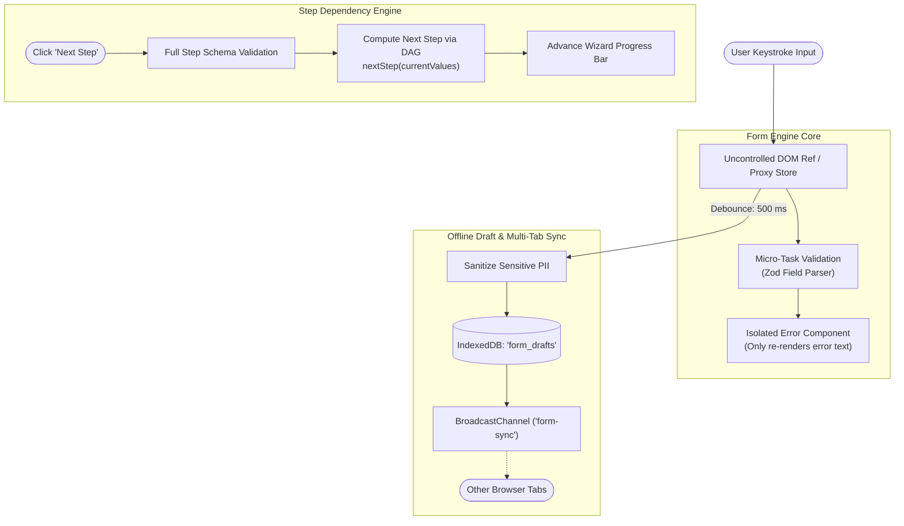

# Design a Multi-Step Form & Wizard Engine (Stripe / TurboTax)

## Step 1: Clarify Requirements

### Functional Requirements
- **Multi-Step Progressive Onboarding**: Guide users through complex multi-page workflows (e.g., tax filing or business verification) with step navigation and breadcrumb progress.
- **Dynamic Conditional Branching**: Compute subsequent form steps dynamically based on previous user answers (e.g., if `entity_type == "LLC"`, route to Corporate Tax step; otherwise, route to Sole Proprietor step).
- **Schema-Driven Field Validation**: Validate inputs at field-level on blur and at step-level on submission using declarative schemas (Zod or Yup).
- **Auto-Save & Offline Draft Recovery**: Silently persist user input to browser storage (`IndexedDB`) with zero data loss if the user closes or refreshes the page.
- **Multi-Tab State Synchronization**: Keep form progress synchronized across multiple browser tabs using `BroadcastChannel`.

### Non-Functional Requirements
- **Zero Input Re-render Lag**: Typing into any individual form field must never trigger re-renders of the surrounding 50+ form fields or wizard layout.
- **Deterministic Step Resolution**: The step dependency graph must be acyclic and resolve transitions in **<5 ms**.
- **Secure Handling of Sensitive Data**: Sensitive fields (SSN, credit cards) must be marked as non-persistable to prevent leaking secrets into unencrypted browser storage.

---

## Step 2: Performance Budgets & Rendering Architecture

### Why Standard React Form State Breaks
In naive React implementations:
```tsx
// BAD: Top-level state forces ALL 50 form fields to re-render on every keystroke!
const [formData, setFormData] = useState({});
```
- Every single keystroke forces a virtual DOM diff of all 50 inputs, triggering layout recalculations and causing visible typing latency on low-end laptops.
- **The Uncontrolled Subscription Architecture**:
  - Keep form state outside the React render tree using a mutable store with field-level subscriptions (the **React Hook Form / Proxy pattern**).
  - Individual inputs register their own DOM refs and re-render **only themselves** when their specific validation state changes.

---

## Step 3: Schema-Driven Form Contract & Dependency Graph

```typescript
// Declarative Form Step Schema
interface FormStepConfig {
  id: string;
  title: string;
  validationSchema: z.ZodObject<any>;
  // Dynamic navigation rule evaluated at runtime
  nextStep: (values: Record<string, any>) => string | null;
  fields: FormFieldConfig[];
}

interface FormFieldConfig {
  name: string;
  label: string;
  type: 'text' | 'select' | 'checkbox' | 'currency';
  isSensitive?: boolean; // Exclude from IndexedDB drafts
  dependsOn?: {
    field: string;
    condition: (val: any) => boolean;
  };
}
```

---

## Step 4: High-Level Architecture



---

## Step 5: Finite State Machine for Step Transitions

```text
Step Dependency Directed Acyclic Graph (DAG):
┌─────────────────────────┐
│ Step 1: Account Details │
└────────────┬────────────┘
             │
             ▼
┌─────────────────────────┐
│ Step 2: Entity Type     │
└────────────┬────────────┘
             │
      ┌──────┴─────────────────────────┐
      │ entity_type == 'Individual'    │ entity_type == 'Corporation'
      ▼                                ▼
┌─────────────────────────┐      ┌─────────────────────────┐
│ Step 3A: Personal Tax   │      │ Step 3B: Corporate EIN  │
└────────────┬────────────┘      └────────────┬────────────┘
             │                                │
             └─────────────────┬──────────────┘
                               ▼
                   ┌─────────────────────────┐
                   │ Step 4: Final Review    │
                   └─────────────────────────┘
```

---

## Step 6: Deep Dive: Uncontrolled Subscriptions, Drafts & Sync

### 1. The Isolated Observer Pattern (React Hook Form Mechanics)
How do we achieve 60fps typing speed across 100 complex fields?
```typescript
class FormStore {
  private values: Record<string, any> = {};
  private listeners: Map<string, Set<() => void>> = new Map();

  setValue(name: string, value: any) {
    this.values[name] = value;
    // Notify ONLY the subscribers of this specific field!
    this.listeners.get(name)?.forEach(cb => cb());
  }

  subscribe(name: string, callback: () => void) {
    if (!this.listeners.has(name)) this.listeners.set(name, new Set());
    this.listeners.get(name)!.add(callback);
    return () => this.listeners.get(name)?.delete(callback);
  }
}
```
- By isolating state mutations to specific field listeners, typing in the `firstName` field leaves the remaining 49 fields untouched by React's reconciliation engine.

### 2. Auto-Saving to IndexedDB with PII Sanitization
Saving drafts to `localStorage` is dangerous because storage is synchronous (blocking the main thread during large writes) and limited to 5 MB:
- **IndexedDB**: Fully asynchronous, non-blocking storage capable of holding hundreds of megabytes.
- **Sanitization Guardrail**:
  ```typescript
  function sanitizeDraft(values: Record<string, any>, fields: FormFieldConfig[]) {
    const safeDraft = { ...values };
    for (const field of fields) {
      if (field.isSensitive) {
        delete safeDraft[field.name]; // Never persist SSN or CVV
      }
    }
    return safeDraft;
  }
  ```

### 3. Multi-Tab Conflict Resolution (`BroadcastChannel`)
What happens if a user opens the onboarding wizard in Tab 1 and Tab 2 simultaneously?
- When Tab 1 completes Step 2 and auto-saves to IndexedDB, it posts a message:
  ```typescript
  const channel = new BroadcastChannel('onboarding_wizard');
  channel.postMessage({ type: 'STEP_COMPLETED', stepId: 'step_2', timestamp: Date.now() });
  ```
- Tab 2 listens to `channel.onmessage`.
- If Tab 2 is currently on an older step, it displays a gentle notification banner:
  > *"You advanced to Step 3 in another tab. Click here to sync your progress."*
- This prevents stale form data in Tab 2 from accidentally overwriting newer progress made in Tab 1!
