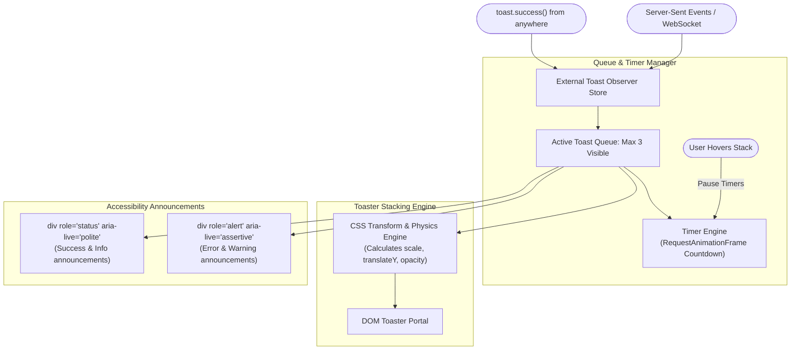

# Design a Real-Time Toast & Notification Center (Sonner / Slack)

## Step 1: Clarify Requirements

### Functional Requirements
- **Imperative Toast API**: Trigger notifications from anywhere in the codebase (React components, Axios network interceptors, utility functions) via `toast.success("Message")` without wrapping callers in React context.
- **Physics-Based Stacking**: Render multiple toasts stacked cleanly on top of one another; expand the stack smoothly on mouse hover to reveal full message details.
- **Auto-Dismiss with Interaction Pause**: Automatically dismiss toasts after a configurable duration (default: 4,000 ms); pause countdown timers when the user hovers over the stack or switches browser tabs.
- **Persistent Notification Center**: An in-app bell icon opening an off-canvas drawer showing historical notifications, unread badges, and "Mark all as read" controls.
- **Strict Accessibility (ARIA Live Regions)**: Announce notifications to screen readers without interrupting ongoing audio or stealing keyboard focus.

### Non-Functional Requirements
- **Zero Framework Re-renders**: Firing a toast must never cause the main application page or layout to re-render.
- **Smooth 60fps Swipe-to-Dismiss**: Support fluid touch and mouse drag gestures with velocity-based dismissal thresholds.
- **Lightweight Footprint**: Core toaster bundle size should be **<3 KB gzip** with zero external animation dependencies.

---

## Step 2: Component Architecture & Public API

### Imperative Public API
```typescript
// Usable anywhere, even outside React components!
toast.success("Deployment successful", {
  description: "Version 2.4.0 is now live in production.",
  action: { label: "View Logs", onClick: () => openLogs() },
  duration: 5000,
});

// Promise-based async loading toast
toast.promise(saveDocument(), {
  loading: "Saving changes...",
  success: "All changes saved.",
  error: "Could not save changes.",
});
```

### Component Placement
```tsx
// Placed once at the root of the application
<Toaster 
  position="bottom-right" 
  visibleToasts={3} 
  closeButton 
  richColors 
/>
```

---

## Step 3: Stacking Physics & Offset Geometry

```text
Collapsed Stack State:
┌──────────────────────────────────────┐  <-- Top Toast (Active, scale: 1.0, z-index: 3)
└──────────────────────────────────────┘
  ┌──────────────────────────────────┐    <-- Toast 2 (scale: 0.95, translateY: -12px, z-index: 2)
  └──────────────────────────────────┘
    ┌──────────────────────────────┐      <-- Toast 3 (scale: 0.90, translateY: -24px, z-index: 1)
    └──────────────────────────────┘

Expanded on Hover State:
┌──────────────────────────────────────┐
│ Top Toast                            │
└──────────────────────────────────────┘
┌──────────────────────────────────────┐
│ Toast 2 (Full height expanded)       │
└──────────────────────────────────────┘
┌──────────────────────────────────────┐
│ Toast 3 (Full height expanded)       │
└──────────────────────────────────────┘
```

---

## Step 4: High-Level Architecture



---

## Step 5: External Observer Pattern (Context-Free State)

Why does standard React context fail for imperative libraries like Sonner?
- Standard React Context requires consuming hooks (`useToast()`) that only work **inside** React component render trees.
- You cannot call `useToast()` inside an Axios response error interceptor!
- **The External Pub-Sub Store**:
  ```typescript
  type ToastListener = (toasts: ToastItem[]) => void;

  class ToastStateStore {
    private toasts: ToastItem[] = [];
    private listeners: Set<ToastListener> = new Set();

    addToast(toast: ToastItem) {
      this.toasts = [toast, ...this.toasts];
      this.notify();
    }

    dismiss(id: string) {
      this.toasts = this.toasts.filter(t => t.id !== id);
      this.notify();
    }

    subscribe(listener: ToastListener) {
      this.listeners.add(listener);
      return () => this.listeners.delete(listener);
    }

    private notify() {
      this.listeners.forEach(l => l(this.toasts));
    }
  }

  export const toastStore = new ToastStateStore();
  export const toast = {
    success: (msg: string) => toastStore.addToast({ id: crypto.randomUUID(), type: 'success', msg }),
    error: (msg: string) => toastStore.addToast({ id: crypto.randomUUID(), type: 'error', msg }),
  };
  ```

---

## Step 6: Deep Dive: Swipe Gestures, Timers & A11y

### 1. Pointer Swipe-to-Dismiss Physics
When users swipe away a toast on mobile:
- Track pointer movement with `onPointerDown`, `onPointerMove`, and `onPointerUp`.
- Calculate drag offset: $\Delta x = x_{\text{current}} - x_{\text{start}}$.
- As $\Delta x$ increases, apply real-time transform: `transform: translateX(Δx)`.
- On release, evaluate swipe velocity:
  - If $\Delta x > 100\text{ px}$ or velocity $> 0.5\text{ px/ms}$, animate the toast off-screen and remove it from the queue.
  - Otherwise, snap the toast smoothly back to position $0$ using CSS spring cubic-bezier transitions.

### 2. Tab Blur & Hover Timer Suspension
If a user switches to another browser tab while a toast is active:
- The user might miss the message completely if the 4,000 ms timer keeps ticking in the background!
- **Visibility & Focus Observers**:
  ```typescript
  document.addEventListener('visibilitychange', () => {
    if (document.hidden) {
      pauseAllTimers();
    } else {
      resumeAllTimers();
    }
  });
  ```
- The same pause logic applies when the user hovers over the toaster container with a mouse.

### 3. Screen Reader Politeness Rules
Assistive technologies can be overwhelmed if toasts spam speech queues:
- **`role="status"` + `aria-live="polite"`**:
  - Used for standard positive outcomes (e.g., *"Changes saved"*).
  - The screen reader waits until the user finishes typing or reading before speaking.
- **`role="alert"` + `aria-live="assertive"`**:
  - Used exclusively for critical errors (e.g., *"Payment failed. Card expired."*).
  - Immediately interrupts current speech synthesizer output to deliver the warning.
