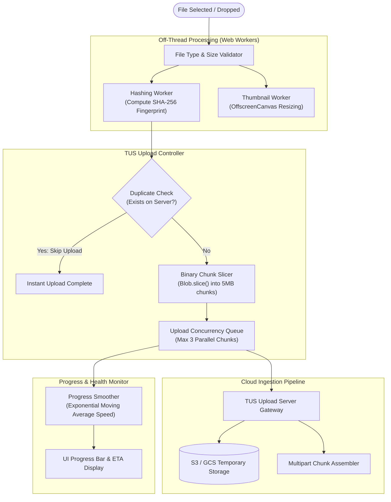

# Design a Resumable File & Video Uploader (YouTube Studio / Uppy)

## Step 1: Clarify Requirements

### Functional Requirements
- **Large File Drag-and-Drop**: Upload multi-gigabyte video and media files (up to 50 GB) directly from browser clients.
- **Resumable Uploads**: If the network connection drops halfway through a 10 GB file, the upload must automatically pause and resume from the exact byte where it left off.
- **Client-Side Image Compression & Previews**: Generate instant local thumbnail previews and compress oversized camera photos using Web Workers before uploading.
- **Dynamic Progress Tracking**: Calculate real-time upload speed (MB/s), percentage completed, and estimated time remaining (ETA).
- **Concurrency & Pause / Cancel Controls**: Support simultaneous multi-file queues with individual pause, resume, and abort triggers.

### Non-Functional Requirements
- **Zero Main-Thread Freezing**: Heavy file slicing, hashing (SHA-256), and canvas image resizing must run in Web Workers without dropping UI frames.
- **Fault-Tolerant Mobile Network Handling**: Automatically retry dropped chunk uploads with exponential backoff and jitter.
- **Bandwidth Efficiency**: Avoid uploading duplicate files by checking client-side file checksums against existing cloud storage assets.

---

## Step 2: Protocol Selection: Multipart vs. S3 Presigned vs. TUS

| Feature | Standard Multipart Form | AWS S3 Presigned URL | TUS Resumable Protocol (Standard) |
|---|---|---|---|
| **Max Single Payload** | ~100 MB (practical) | 5 GB (single PUT) | **Unlimited (Chunked Stream)** |
| **Resumable on Disconnect** | **No** (Must restart from 0%) | Complex (Manual S3 Multipart) | **Built-in First-Class (Offset based)** |
| **Network Efficiency** | Poor (Repeats failed uploads) | Moderate | **Optimal (Uploads only missing bytes)** |
| **Open Ecosystem** | Generic HTTP | AWS proprietary | **Open IETF Standard (Uppy, Vimeo, Cloudflare)** |

---

## Step 3: The TUS Resumable Protocol Specification

The open **TUS protocol** coordinates resumable uploads using three standard HTTP methods:

```text
TUS Upload Handshake & Transfer Flow:
Client Browser                                             TUS Upload Server
      │                                                           │
      │ 1. POST /files (Upload-Length: 104857600)                 │
      ├──────────────────────────────────────────────────────────>│
      │ 2. HTTP 201 Created (Location: /files/upload_9921)         │
      │<──────────────────────────────────────────────────────────┤
      │                                                           │
      │ 3. PATCH /files/upload_9921 (Upload-Offset: 0, Chunk 1)   │
      ├──────────────────────────────────────────────────────────>│
      │ 4. HTTP 204 No Content (Upload-Offset: 52428800)          │
      │<──────────────────────────────────────────────────────────┤
      │                                                           │
      │ ~~~ [NETWORK CONNECTION DROPS - USER LOSES WIFI] ~~~     │
      │                                                           │
      │ 5. HEAD /files/upload_9921 (Query Server for Progress)    │
      ├──────────────────────────────────────────────────────────>│
      │ 6. HTTP 200 OK (Upload-Offset: 52428800)                  │
      │<──────────────────────────────────────────────────────────┤
      │                                                           │
      │ 7. PATCH /files/upload_9921 (Upload-Offset: 52428800)     │
      │    [Upload remaining bytes from exact offset!]            │
      ├──────────────────────────────────────────────────────────>│
      │ 8. HTTP 204 No Content (Upload-Offset: 104857600) [DONE]  │
      │<──────────────────────────────────────────────────────────┤
```

---

## Step 4: High-Level Architecture & Pipeline



---

## Step 5: Client-Side File Slicing & Chunk Data Model

The browser `File` object inherits from `Blob`, allowing zero-copy memory slicing:

```typescript
interface UploadChunk {
  chunkIndex: number;
  startByte: number;
  endByte: number;
  blob: Blob;
}

function sliceFileIntoChunks(file: File, chunkSize: number = 5 * 1024 * 1024): UploadChunk[] {
  const chunks: UploadChunk[] = [];
  let offset = 0;
  let index = 0;

  while (offset < file.size) {
    const end = Math.min(offset + chunkSize, file.size);
    chunks.push({
      chunkIndex: index++,
      startByte: offset,
      endByte: end,
      blob: file.slice(offset, end), // Zero-copy native browser pointer
    });
    offset = end;
  }
  return chunks;
}
```

---

## Step 6: Deep Dive: Web Workers, Dynamic Chunks & Backoff

### 1. Off-Thread Image Compression with `OffscreenCanvas`
Decoding and resizing a 48-megapixel iPhone photo (8,000 $\times$ 6,000 pixels) on the main UI thread freezes animations for **>800 ms**:
- **Solution: OffscreenCanvas in Web Workers**:
  ```typescript
  // worker.ts
  self.onmessage = async (e: MessageEvent<{ file: File, maxWidth: number }>) => {
    const bitmap = await createImageBitmap(e.data.file);
    const scale = e.data.maxWidth / bitmap.width;
    const canvas = new OffscreenCanvas(bitmap.width * scale, bitmap.height * scale);
    const ctx = canvas.getContext('2d')!;
    ctx.drawImage(bitmap, 0, 0, canvas.width, canvas.height);
    
    const compressedBlob = await canvas.convertToBlob({ type: 'image/jpeg', quality: 0.82 });
    self.postMessage({ compressedBlob });
  };
  ```
- The main thread remains at a silky-smooth 120fps while the background thread shrinks a 25 MB camera photo down to a crisp 1.2 MB upload!

### 2. Adaptive Dynamic Chunk Sizing
Fixed 5 MB chunks perform poorly across diverse network conditions:
- On slow 3G cellular connections: 5 MB chunks time out repeatedly.
- On fast gigabit fiber connections: 5 MB chunks create unnecessary HTTP round-trip overhead.
- **Adaptive Chunk Algorithm**:
  - Start with a conservative 1 MB chunk.
  - Measure upload duration:
    - If chunk upload takes $< 1.0\text{ sec}$, double the next chunk size (up to 32 MB).
    - If chunk upload takes $> 5.0\text{ sec}$ or fails, halve the chunk size (down to 512 KB).

### 3. Smoothed ETA Calculation (Exponential Moving Average)
Raw `bytesLoaded / totalTime` produces wildly fluctuating ETA countdowns that jitter uncontrollably:
- **Exponential Moving Average (EMA)**:
  $$\text{Speed}_{\text{new}} = \alpha \times \text{CurrentSpeed} + (1 - \alpha) \times \text{Speed}_{\text{prev}} \quad (\alpha = 0.2)$$
- Smoothing prevents sudden spikes when a chunk completes, delivering a steady, professional countdown timer (e.g., *"About 2 minutes remaining"*).
